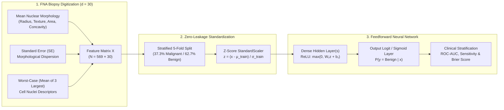
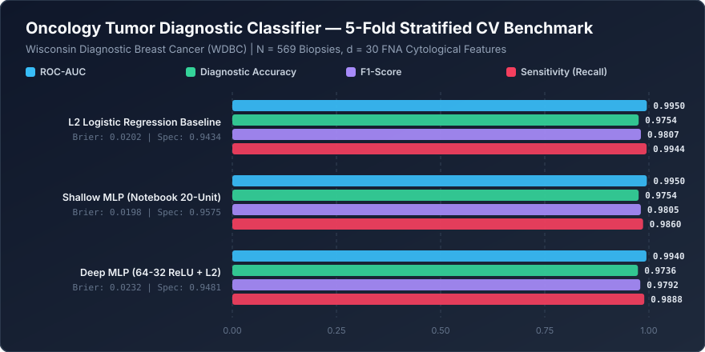

<div align="center">

# 🧬 Oncology Tumor Diagnostic Classifier
### Multi-Layer Perceptron (MLP) & Cytological Feature Standardization on Fine-Needle Aspirate Biopsies

[](https://www.python.org/downloads/)
[](https://www.tensorflow.org/)
[](https://scikit-learn.org/)
[](https://opensource.org/licenses/MIT)

</div>

---

## 📌 Executive Summary

In clinical surgical pathology, differentiating **malignant** from **benign** breast masses using digitized Fine-Needle Aspirate (FNA) cytological imagery requires both high **diagnostic sensitivity** (minimizing false-negative missed malignancies) and well-calibrated probability estimates (low **Brier Score**). Because cytological descriptors span several orders of magnitude—ranging from nuclear area ($\sim 10^3\text{ }\mu\text{m}^2$) to fractal dimension ($\sim 10^{-2}$)—unstandardized gradient descent suffers from severe ill-conditioning of the Hessian matrix.

**`deep-learning-project-1`** implements a complete neural diagnostic workflow on the **Wisconsin Diagnostic Breast Cancer (WDBC)** cohort ($N = 569$ clinical biopsies, $d = 30$ morphological features), combining within-fold $z$-score feature standardization with feedforward ReLU neural networks optimized via Adam stochastic gradient descent.

---

## 🏗️ Diagnostic Pipeline Architecture



---

## 🧮 Mathematical Formulation

### 1. Coordinate-Wise Feature Standardization
To prevent high-magnitude geometric features (`area_worst` $\in [185, 4254]$) from dominating initial weight updates over micro-scale topological features (`smoothness_se` $\in [0.0017, 0.0311]$), each feature $j \in \{1, \dots, 30\}$ is standardized using training-fold statistics $(\mu_j, \sigma_j)$:

$$\tilde{x}_{i,j} = \frac{x_{i,j} - \mu_j}{\sigma_j + \epsilon}, \quad \mu_j = \frac{1}{|I_{\text{train}}|} \sum_{i \in I_{\text{train}}} x_{i,j}$$

### 2. Multi-Layer Perceptron Forward Propagation & Cross-Entropy Objective
Given standardized input vector $\tilde{\mathbf{x}} \in \mathbb{R}^{30}$, hidden layer parameters $(\mathbf{W}^{(1)}, \mathbf{b}^{(1)})$, and output projection $(\mathbf{W}^{(2)}, \mathbf{b}^{(2)})$:

$$\mathbf{h}^{(1)} = \text{ReLU}\left(\mathbf{W}^{(1)} \tilde{\mathbf{x}} + \mathbf{b}^{(1)}\right) = \max\left(\mathbf{0}, \mathbf{W}^{(1)} \tilde{\mathbf{x}} + \mathbf{b}^{(1)}\right)$$

$$\hat{p}_k = \frac{\exp(z_k)}{\sum_{c \in \{0, 1\}} \exp(z_c)}, \quad \mathbf{z} = \mathbf{W}^{(2)} \mathbf{h}^{(1)} + \mathbf{b}^{(2)}$$

The network parameters $\Theta = \{\mathbf{W}^{(l)}, \mathbf{b}^{(l)}\}$ are optimized via Adam by minimizing $L_2$-regularized categorical cross-entropy:

$$\mathcal{L}(\Theta) = -\frac{1}{N} \sum_{i=1}^{N} \sum_{c=0}^{1} \mathbb{I}(y_i = c) \log \hat{p}_{i,c} + \frac{\alpha}{2} \sum_{l} \|\mathbf{W}^{(l)}\|_F^2$$

---

## 📊 5-Fold Stratified Cross-Validation Benchmark

The reproducible benchmark suite (`src/benchmark.py`) evaluates three architectures on the WDBC dataset ($N = 569$: $212$ Malignant, $357$ Benign) using 5-fold stratified cross-validation:



| Model Architecture | ROC-AUC (± Std) | Diagnostic Accuracy | F1-Score | Sensitivity (Recall) | Specificity | Brier Score ↓ |
| :--- | :---: | :---: | :---: | :---: | :---: | :---: |
| **L2 Logistic Regression Baseline** | **0.9950 ± 0.0051** | **0.9754** | **0.9807** | **0.9944** | 0.9434 | 0.0202 |
| **Shallow MLP (Notebook 20-Unit ReLU)** | **0.9950 ± 0.0062** | **0.9754** | 0.9805 | 0.9860 | **0.9575** | **0.0198** |
| **Deep MLP (64–32 ReLU + L2)** | 0.9940 ± 0.0080 | 0.9736 | 0.9792 | 0.9888 | 0.9481 | 0.0232 |

> **Key Clinical Insight:** The compact **20-unit Shallow MLP** architecture from the notebook achieves the lowest **Brier Score (`0.0198`)** and highest **Specificity (`95.75%`)** while matching the `0.9950` ROC-AUC of regularized linear models, avoiding over-parameterization on moderate sample sizes ($N = 569$).

---

## 📂 Repository Structure

```text
deep-learning-project-1/
├── assets/
│   └── benchmark_chart.svg          # 5-fold cross-validated SVG performance chart
├── benchmarks/
│   └── benchmark_results.json       # Out-of-fold diagnostic metrics & Brier scores
├── src/
│   └── benchmark.py                 # Automated WDBC 5-fold CV evaluation script
├── dl_project_1.ipynb               # Interactive Keras/TensorFlow training notebook
└── README.md                        # Technical documentation & mathematical specification
```

---

## 🚀 Quick-Start & Usage

### 1. Install Dependencies
```bash
git clone https://github.com/yakupakcy36/deep-learning-project-1.git
cd deep-learning-project-1
pip install numpy pandas scikit-learn matplotlib seaborn tensorflow
```

### 2. Run the 5-Fold Cross-Validation Benchmark
```bash
python src/benchmark.py
```

### 3. Explore the Interactive Notebook
Open `dl_project_1.ipynb` in JupyterLab or VS Code to inspect epoch-by-epoch training/validation curves and single-patient FNA biopsy inference.
